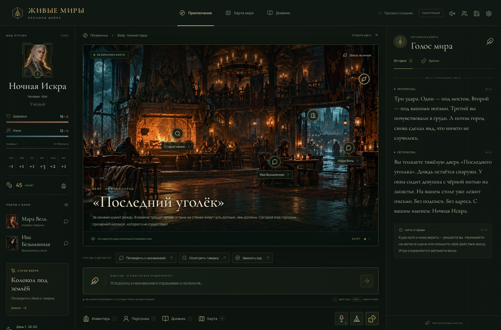

# LIVING REALMS · Живые миры

An illustrated, Russian-language, single-player fantasy RPG set in **Вейр** — a city that hears bells beneath the ground, seven years after every bell was removed. Create a character, follow or ignore three opening mysteries, explore nine locations, negotiate, steal, trade, fight, buy a tavern, and live with persistent consequences.

This is a runnable game, with an intentionally bounded authored offline campaign and an optional OpenAI interpreter/narrator. It is **not an unlimited world simulator**. See the limits below.



## Start locally

Requirements: **Node.js 22.13+** (tested with 26.10), npm, and a modern browser. SQLite is provided by Node; no external database, account, Docker, or API key is needed.

```sh
npm install
npm run dev
```

Open **http://127.0.0.1:5173**. Vite serves the interface and proxies `/api` to Express on port 3001. Keep using the same host and browser profile to retain your anonymous session. All game actions save automatically to `data/realms.sqlite`.

For a production build served by one local process:

```sh
npm run build
npm start
```

Open **http://127.0.0.1:3001**. `npm start` requires a prior build. Both modes bind to loopback by default. Nothing is published or deployed.

If port 3001 is occupied, stop the old game server first. For production, `PORT` and `HOST` are configurable; the development proxy is deliberately fixed to port 3001 in `vite.config.ts`.

## Optional AI provider

Copy the example and edit `.env` locally. Never put a key in client code, a `VITE_` variable, chat, or source control.

```sh
cp .env.example .env
```

```dotenv
OPENAI_API_KEY=your_local_key
OPENAI_MODEL=gpt-4.1-mini
PORT=3001
HOST=127.0.0.1
DATABASE_PATH=./data/realms.sqlite
```

Restart the server. The header changes from **СИМУЛЯЦИЯ** to **ИИ-МАСТЕР** when a key is configured; this indicates configuration, not an authenticated provider health check. Choose an available model supporting the Responses API and strict JSON-schema structured outputs. The model ID is configurable and is not dynamically selected.

The server sends a compact current context to OpenAI's Responses endpoint, validates one proposed intent with Zod, and executes only an allowlisted server handler. Dialogue receives only the current NPC's local knowledge. A second optional response writes grounded prose **after** the mechanical transaction commits. Generic nonmaterial improvisation gets a server-selected skill check; it cannot fabricate inventory, money, deaths, property or locations. Model-generated prose is never used as a state mutation.

On timeout, rate limit, invalid JSON, refusal, authentication failure, or other interpretation errors, the action falls back to the authored interpreter and a Russian notice appears in the chronicle. If only the optional prose call fails, the committed authored outcome remains. Requests time out after 25 seconds each. No live key was available during implementation: the adapter was tested with mocked HTTP responses, **not a real paid API call**.

Official contract reference: [OpenAI Structured Outputs](https://developers.openai.com/api/docs/guides/structured-outputs).

## Play

- Create a name, ancestry, class, background, attribute focus, and portrait. Classes have different attributes, equipment, hit points, mana, and abilities.
- Click scene markers or enter Russian natural-language actions. `Enter` submits; `Shift+Enter` inserts a line break. Suggestions are conveniences, not the only actions.
- Offline examples: `Поговорить с Ивой`, `Я пытаюсь убедить Иву, что умею хранить тайны`, `Обыскать камин`, `Иду на площадь`, `Поговорить с Сычом`, `Освободить заключённого хитростью`, `Купить зелье`, `Я хочу открыть таверну`.
- `I`: inventory; `C`: character; `J`: journal; `M`: map; `Esc`: adventure. Matching Russian keyboard-layout keys also work. Shortcuts are ignored while typing.
- The map allows travel along connected roads. The crypt is locked until you have the key. The cave layout is generated once from the campaign seed and persists.
- In combat, click up to three traversable cells away to move once, select an enemy, then attack, cast, guard, use a potion or attempt to flee. Melee requires adjacency. Walls block fire spells. The enemy acts after your action, or first if it wins initiative.
- Warriors use Second Wind once per rest; mages cast a fire spark; wardens heal. Rogues gain extra damage against wounded enemies. The crypt's echo can force wisdom saving throws against fear.
- Rest in a tavern, temple or the abandoned village; time advances and factions continue their agendas. Defeat rescues the hero at a cost instead of destroying the campaign.
- Buying, equipping and selling are real validated transactions. To sell equipped gear, first equip something else. Food cannot be consumed in combat. Full-health consumables are not wasted.
- The free dice tray supports d4, d6, d8, d10, d12 and d20, advantage and disadvantage. Free dice do not override a resolved check.
- Named save bookmarks can be restored independently of autosave. The save screen also switches between your campaigns. Returning to the menu does not delete progress.
- Sound is off initially. Settings include volume, motion reduction, particles and larger narrative text. Desktop has a persistent chronicle; mobile has world/chronicle tabs.

### An optional opening route

Talk to Ива → visit the square → temple → crypt → inspect the bell → defeat its guardians → return to Весна. Or seek Сыч's prisoner rescue, follow Орен into the forest, explore ruins, trade, or ignore all three. Scheduled events can change or close an opportunity without ending the campaign.

## What is implemented

- Full Russian interface: illustrated menu, three-stage creator, exploration, tactical combat, inventory/equipment/shop, character sheet, world map, journal, settings, named saves and explicit single-player lobby information.
- Four classes, four ancestries, five backgrounds, six portraits, six recurring NPCs, nine connected locations, six factions, three authored opening quest arcs, discoveries, one generated cave layout, persistent buildings destroyed by fire, and permanent named-NPC deaths after actual combat.
- Health, mana, equipment, currency, XP/levels, proficiency, ability checks, saving throws, advantage/disadvantage, initiative, AC, critical combat hits, damage, healing, fear, wound/smoke statuses, movement, obstacles, enemy pursuit and combat rewards.
- An authored offline intent interpreter with clear unsupported-action feedback. OpenAI adapter for broader phrasing, contextual dialogue and constrained nonmaterial improvisation.
- Time-based faction agendas, witness-specific crime memories, dead-NPC absence and closed services, relationship changes, reputation, wanted status, finite merchant stock, validated sales, nonrepeatable loot/quest rewards and purchasable income-generating property.
- SQLite WAL persistence, atomic world/hero updates, optimistic versions, duplicate action protection, HttpOnly session ownership, same-origin checks, request limits, bounded model context and server-only keys.
- Original generated illustrations and portraits, original SVG scenes/cartography, locally served Cyrillic fonts, responsive layouts, particles, transitions, generated rain ambience and interaction sounds.

## Validation

```sh
npm run check
npm test
npm run build
```

`npm test` executes the rules, persistence and AI-adapter tests in one process, avoiding loader behavior differences across Node versions. Randomness is dependency-injected for deterministic mechanical tests. Production rolls use `node:crypto.randomInt`.

Browser tests use an **isolated** SQLite database in the operating-system temp directory and a separate production server on port 3101:

```sh
npx playwright install chromium --only-shell
npm run build
npm run test:e2e
```

If using a custom browser cache, set `PLAYWRIGHT_BROWSERS_PATH` consistently for installation and tests. This implementation session used `/tmp/lr-playwright`. Linux may require Playwright's documented browser system libraries.

The browser suite covers desktop/mobile creation, the opening scene, NPC dialogue, free-text checks, dice, shopping, saved bookmarks, reload persistence, travel, restoration, combat movement, enemy turns, spell resource costs, combat reloads, settings, overflow, session isolation, invalid schemas, duplicate IDs and stale versions. Screenshots are in `docs/`; failure traces and the HTML report are ignored build artifacts. See [QA](docs/QA.md) for the actual final results and limits.

## Architecture and persistence

See [architecture](docs/ARCHITECTURE.md), [asset provenance and prompts](docs/ASSETS.md), [rules attribution](public/credits.html), and [continuation work](TODO.md).

The browser stores only presentation preferences and the last campaign ID. The HttpOnly session cookie identifies the owner; the server owns all campaign state. SQLite stores the campaign aggregate as JSON in a transaction, named snapshots separately, and processed action IDs for idempotency. This deliberately simpler local design avoids PostgreSQL/Prisma setup while retaining atomicity and restart persistence.

To back up a campaign, **stop the server**, then copy `data/realms.sqlite` and preserve the browser profile/cookie. A visible-chronicle JSON export is a readable record, **not** an importable save. There is no account recovery if the session cookie is deleted. Do not treat anonymous local sessions as internet-ready authentication.

## Deliberate limits and next development priorities

1. **Single player.** Lobby UI explains the limitation; rooms, networking, independent characters and private multiplayer actions are not implemented.
2. **Bounded world simulation.** The model interprets natural language but cannot implement arbitrary new systems. Revolutions, romance, businesses and crime have only the mechanical effects expressly supported above. No unlimited generated geography, fully autonomous NPC lives, detailed poisoning, monarch succession, cult management or merchant empires.
3. **Finite authored content.** Nine locations and three quest arcs form a complete opening campaign, not a full-length commercial RPG. The crypt can be resolved; exploration remains available afterward. Generated caves reuse the tactical tile set.
4. **Adapted rules.** No full SRD character builder, full spellbook, multiplayer initiative, opportunity attacks, full stealth system, equipment class restrictions, permanent death or encumbrance penalties. Inventory weight is informational. Wounds are descriptive; smoke affects checks/attacks, and fear affects attacks until resisted.
5. **AI prose is non-authoritative.** Schema validation prevents arbitrary mutation, not every possible narrative inconsistency. Grounding is enforced by narrow contexts and prompts; a live-model quality pass remains necessary. No streaming responses, provider cost accounting or alternate provider yet.
6. **Local persistence model.** No distributed locks, multi-process server support, account login, save import, migrations framework or remote deployment hardening. Session cookie ownership and version checks are intended for one local server. Named snapshots retain their originating campaign.
7. **Presentation.** Two painted scenes and one portrait atlas are generated original assets. Other scenes and the world map are original programmatic illustrations. Sound is synthesized; no recorded soundtrack. Browser tests do not establish audio fidelity or every device/browser's accessibility.

Next priorities: a live-provider acceptance pass; richer validated interaction/effect schemas and authored quest consequences; then authenticated multiplayer with room-scoped authorization, per-character views, independent turns and integration tests. Preserve server authority while expanding the simulation.
